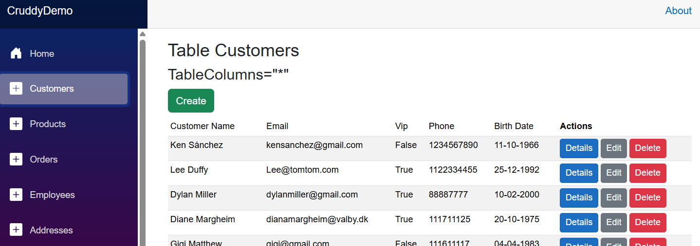
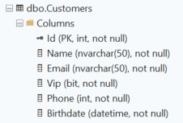
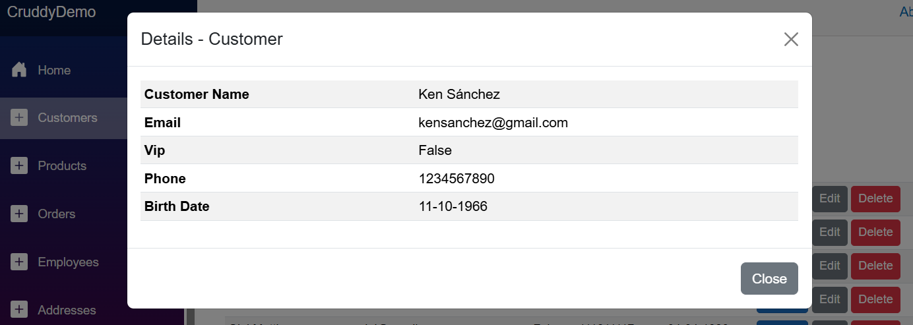
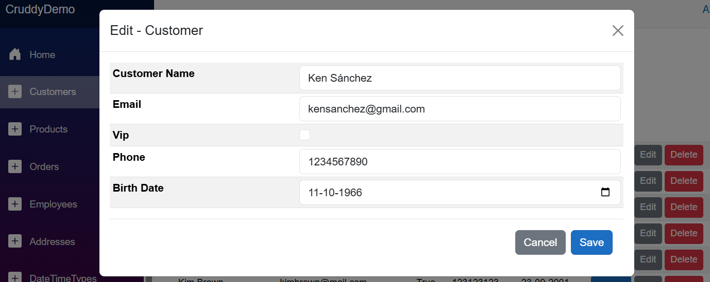
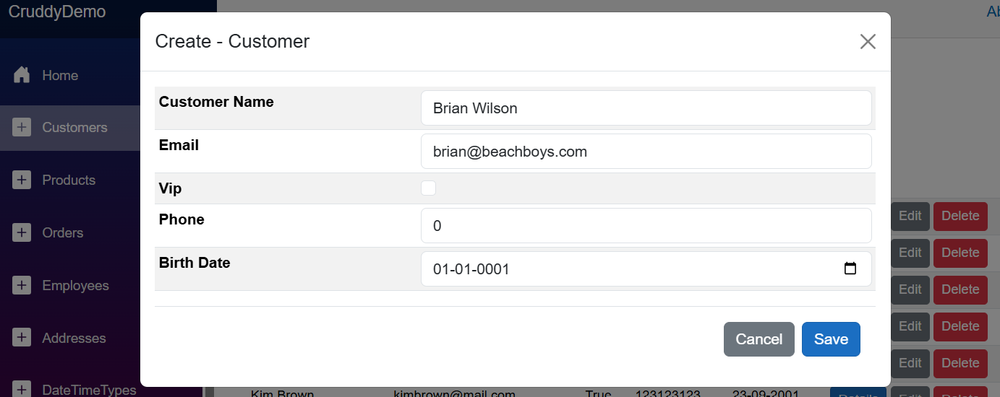
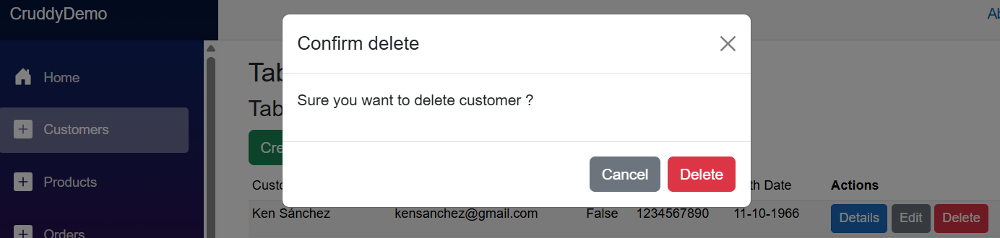

# Cruddy

Why Cruddy? -I needed a simple component that could do CRUD operations on any database table.
I wanted to be able to use it with any class or record. It had to use Dapper for database operations. 

## Overview

- Cruddy is an ASP.NET Blazor component that does CRUD operations on any table in any database
- Cruddy is based on the Microsoft QuickGrid component
- Cruddy requires a model class or record
- When editing or creating validation is done based on the class properties and attributes (DataAnnotations) 
- The model class/record properties do not need to match the database table columns
- Cruddy uses Dapper - not Entity Framework
- Cruddy will generate the appropriate CRUD SQL statements
- Cruddy does not use any non-Microsoft NuGet packages (except for Dapper)
- Foreign keys are handled by Cruddy - See the FKeys parameter in the table below

## How to contribute

You can contribute to Cruddy by creating a pull request on GitHub.
Please follow normal/typical coding standards and include tests for changes and new features.

Please run the tests locally: You need to set up a local database with the provided SQL script. 
Else the database tests will not be run. I have not set up a test database in GitHub Actions yet.

## Roadmap for version 1

- Date for version 1: Before end of 2026
- Get stable and usable for production
- Make it a NuGet package

## Examples 

Note: There are more examples in the CruddyDemo project.

Typical use:

```razor
@page "/Customers"
@inject Microsoft.Data.SqlClient.SqlConnection dbConnection

<h3>Table Customers</h3>

<h4>TableColumns="*"</h4>
<Cruddy TEntity="Models.Customer" AllowCrud="true" DbConnection="dbConnection" HideKeyColumn="true" />

@code {
}
```

The razor above will result in this QuickGrid:


Models.Customer:
```csharp   
public class Customer
{
    public Customer() { }

    [Key]
    public int Id { get; set; }

    [DisplayName("Customer Name")]
    public required string Name { get; set; }

    [MaxLength(30, ErrorMessage = "Email cannot exceed 30 digits.")]    
    public required string Email { get; set; }

    public bool Vip { get; set; }

    public int Phone { get; set; }

    [DisplayName("Birth Date")]
    public DateTime Birthdate { get; set; }
}
```
If the model class has a property with the attribute [Key], Cruddy will use that property as the primary key column. 
If no property has the [Key] attribute, Cruddy will try to find a property named "Id" or "{ClassName}Id" and use that as the primary key column.
Or use the KeyColumn parameter to specify the primary key column name.

Table Customers:


Details, Edit, Create and Delete modals:





Most simple use (no CRUD):
```razor
@page "/Products"
@inject Microsoft.Data.SqlClient.SqlConnection dbConnection

<h3>Table Products</h3>

<h4>Simple as possible</h4>
<Cruddy TEntity="Models.Product" DbConnection="dbConnection" />

@code {}
```

Advanced use example 1:
```razor
@page "/AnyPoco"
@inject Microsoft.Data.SqlClient.SqlConnection dbConnection

<h3>Select into any POCO class</h3>

<h4>SELECT Id, Name, LTRIM(STR(Price)) AS Info FROM Products</h4>
<Cruddy TEntity="Models.AnyPoco" Select="SELECT Id, Name, LTRIM(STR(Price)) AS Info FROM Products" DbConnection="dbConnection" />

@code {}
```

Advanced use example 2:
```razor
<Cruddy TEntity="Models.OrderCruddy" TableName="Orders" TableColumns="Id, CustomerName, ProductName, Qty, Paid, OrderDate" Select=@sql DbConnection="dbConnection" />

@code {
    string sql = @"
        SELECT o.Id, c.Name AS CustomerName, p.Name AS ProductName, Pid, o.Qty, o.Paid, o.OrderDate FROM Orders o
        INNER JOIN Customers c ON c.Id = o.Cid
        INNER JOIN Products p ON p.Id = o.PId
";
}
```

Note how attribute Key, DisplayName and DisplayFormat are used in the model classes.

## Database related parameters - CruddyBase.cs:

| Parameter | Description |
|-----------|-------------|
| DefaultSchema | The default schema for the database table (default: "dbo"). |
| TableName | Name of the database table to operate on. If not specified the TEntity class name is used. |
| PluralizeTableName | Whether to pluralize TableName when building SQL (adds an 's'). |
| TableColumns | The columns to retrieve from the table, separated by commas (default: "*"). |
| KeyColumn | The primary key column name. If not specified the component will try to infer it from attributes or common naming (Id / {Class}Id). |
| AllowKeyColumnEditOnCreate | Whether to allow editing of the key column when creating rows (not when updating). Default is false. |
| Top | Maximum number of rows to retrieve (default: 10000). |
| Distinct | Whether to retrieve only distinct rows. |
| OrderBy | Columns to order the result by (comma separated). Works together with SortOrder. |
| Where | SQL WHERE clause (without the "WHERE" keyword) to filter results. |
| SortOrder | Sorting order for OrderBy (Ascending / Descending). |
| Select | If provided, this full SQL SELECT statement will be used instead of the generated one. |
| DbConnection | An ADO.NET DbConnection (e.g. SqlConnection) used by Dapper to query and modify the database. |
| FKeys | Foreign key info in format "FKey: PrimaryTable, PrimaryId, PrimaryDisplay; FKey2: ...". Or just the foreign key column name(s) and Cruddy will try to guess the rest. |

## UI and formatting related parameters - Cruddy.razor.cs:

| Parameter | Description |
|-----------|-------------|
| DefaultDateFormat | Default date format used when no DisplayFormatAttribute is present. Default: d (aka 'Short date pattern'). |
| DefaultDateTimeFormat | Default date and time format used when no DisplayFormatAttribute is present. Default: g (aka 'General date/time pattern'). |
| DefaultTimeFormat | Default time format used when no DisplayFormatAttribute is present. Default: t (aka 'Short time pattern'). |
| DefaultDecimalFormat | Default decimal/double/float format when no DisplayFormatAttribute is present. Default format is 0.00. |
| DefaultNumberFormat | Default integer number format when no DisplayFormatAttribute is present. Default format is 0. |
| ActionsTitle | Title to use for the actions column (default: "Actions"). |
| AllowCreate | Enable the create functionality. |
| AllowDetails | Enable per-row Details button that opens a modal showing all TEntity fields. |
| AllowEdit | Enable per-row edit button and edit functionality. |
| AllowDelete | Enable per-row delete button and delete behaviour. |
| AllowCrud | Same as setting AllowCreate, AllowDetails, AllowEdit and AllowDelete to true |
| DetailsColumns | List of table columns, separated by commas, to display in the Details modal. If "*" is specified, all public readable properties of TEntity will be displayed. If empty string TableColumns is used. |
| HideKeyColumn | Whether to hide the key column in the table. |
| ReloadPageAfterChange | Whether to update the whole page after a change (create, edit, delete) is made, or just the component. If true, the page will be refreshed after a change is made. If false, the in-memory list of rows will be updated and the UI will be refreshed without reloading the page. |
| NameUx | The property name used as the human-readable item label in UX prompts (e.g. in delete confirmation messages). |
| CruddyGridTheme | Theme applied to the QuickGrid. Default is "twentyAI". |
| CruddyGridClass | CSS class applied to the QuickGrid. Default is "table table-sm table-index table-striped small table-fit table-thead-sticky mb-0". |
| ModalTableClass | CSS class applied to the modal table. Default is "table table-sm table-striped". |

## Requirements

- .NET 10
- Bootstrap 5

## Get Started

- Create database CruddyDB
- Run script CruddyDB test database.sql
- Compile and run CruddyDemo project

## Known issues
- It's a beta! Needs beautification...
- Only tested with MS SQL Server - but should work with any database that Dapper supports
- Method DapperRepository.Add() will need more work for other databases than MS SQL Server
- Cruddy does not support composite primary keys (no plans for that in version 1)
